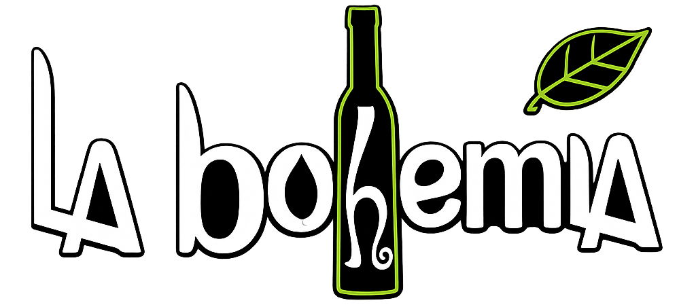
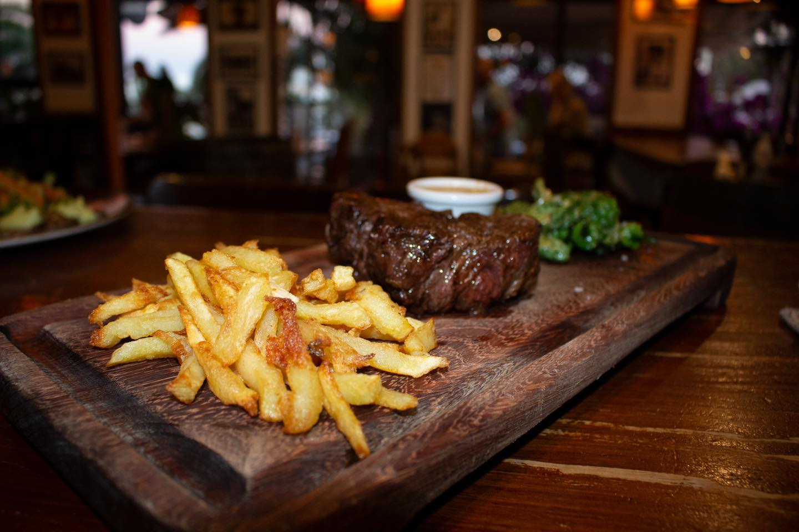
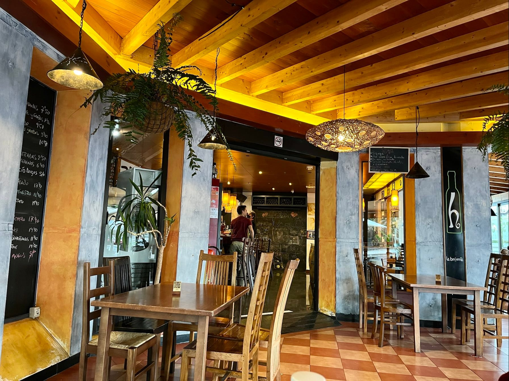

# La Bohemia · Lanzarote

### Concepto visual de una web de restaurante · Experimentación con herramientas de IA

**Proyecto experimental · Diseño frontend · HTML, CSS y JavaScript**

---

## Sobre el proyecto

**La Bohemia · Lanzarote** es un proyecto experimental creado para **probar y comparar distintas herramientas de inteligencia artificial** aplicadas al diseño y desarrollo de interfaces web.

El resultado es una propuesta visual de página para un restaurante de **Costa Teguise, Lanzarote**, con una estética editorial, fotografías gastronómicas, tipografías cuidadas, animaciones y adaptación a diferentes dispositivos.

**Se trata únicamente de una demostración visual (frontend).** No dispone de backend, base de datos ni funcionalidades de gestión conectadas a un servidor.

## Características visuales

- **Presentación visual:** portada a pantalla completa, fotografías y recursos audiovisuales.
- **Navegación por secciones:** experiencia, especialidades, galería, carta, reseñas y reservas.
- **Diseño responsive:** adaptación a diferentes tamaños de pantalla.
- **Menú móvil:** navegación desplegable para pantallas pequeñas.
- **Animaciones y efectos:** transiciones y elementos interactivos en el navegador.
- **Galería gastronómica:** imágenes del local, platos y espacios.
- **Enlaces externos:** accesos visuales a WhatsApp, mapas y redes sociales.

Las secciones relacionadas con reservas o contacto forman parte de la presentación visual; **no existe un sistema propio de gestión de reservas**.

## Tecnologías

| Área | Tecnologías |
| --- | --- |
| **Estructura** | HTML5 |
| **Estilos y diseño** | CSS3 · variables CSS · media queries |
| **Interactividad visual** | JavaScript (vanilla) · DOM |
| **Tipografía** | Google Fonts: Playfair Display, Cormorant Garamond y DM Sans |
| **Iconografía** | Font Awesome |
| **Contenido multimedia** | Imágenes JPG/PNG · vídeo MP4 |

## Diseño y recursos

| Gastronomía | Ambiente |
| :---: | :---: |
|  |  |

## Estado del proyecto

**Prueba de concepto exclusivamente visual**, realizada como ejercicio de experimentación con diferentes herramientas de IA.

El objetivo ha sido explorar posibilidades de diseño, composición y experiencia de usuario, sin desarrollar una aplicación completa. **No incluye backend, base de datos, panel de administración ni integración funcional de reservas.**

## Autor

**Fernando Montelongo Moreno** · Full Stack Developer · DAM + DAW

---
