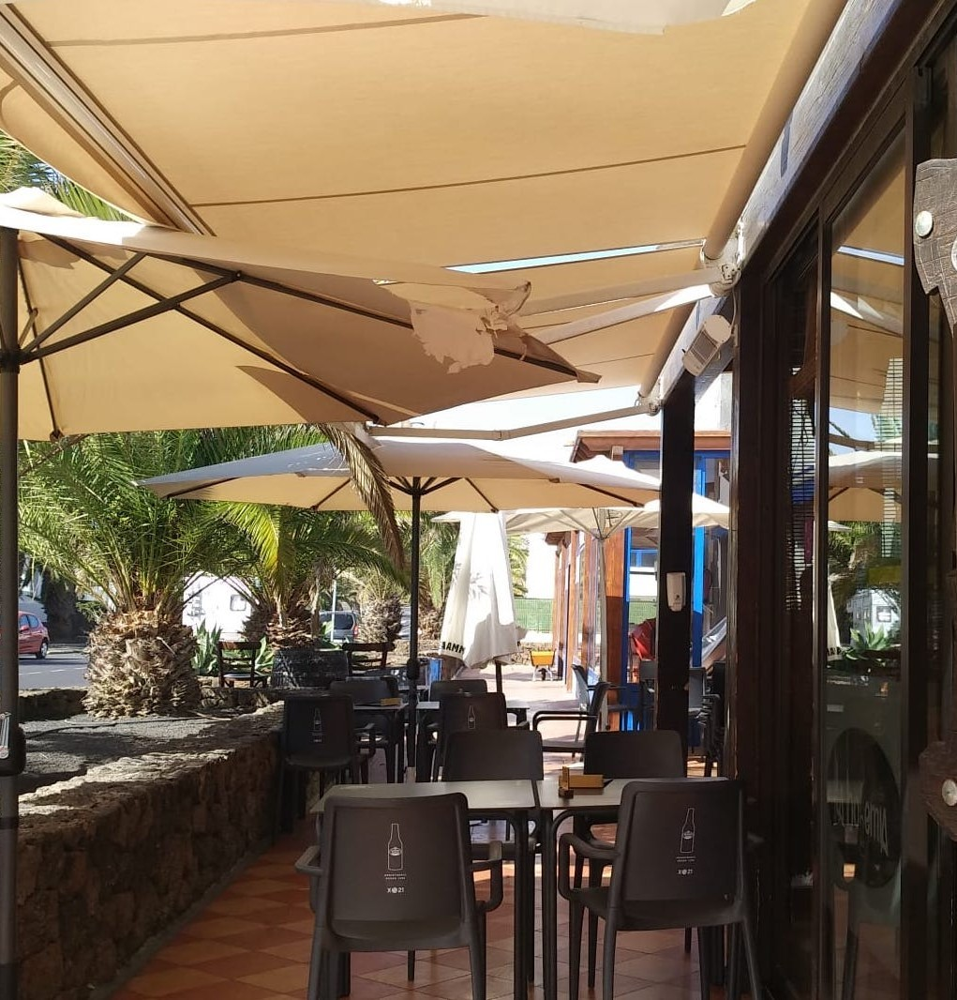

<div align="center">


# La Bohemia · Lanzarote

### Landing page de restaurante con diseño editorial, animaciones y experiencia responsive

**Desarrollo frontend · Web corporativa · HTML, CSS y JavaScript**


[](#estado-del-proyecto)
[](#sobre-el-proyecto)
[](https://github.com/fmoorenoo/la_bohemia)

</div>

---

## Sobre el proyecto

**La Bohemia · Lanzarote** es una propuesta de página web para un restaurante de **Costa Teguise, Lanzarote**. Presenta el establecimiento mediante una experiencia visual de estilo editorial, con tipografía cuidada, fotografía gastronómica, animaciones y secciones de navegación orientadas a dar a conocer su oferta.

La implementación utiliza **HTML5, CSS3 y JavaScript sin frameworks**. El código de la página, los estilos y la lógica de interacción se encuentran en `index.html`, acompañados por imágenes y vídeos locales.

> Este repositorio contiene el desarrollo de una web de presentación. Su publicación en GitHub no acredita, por sí sola, que sea la web oficial actual del establecimiento ni que sus contenidos comerciales estén actualizados.

## Funcionalidades

- **Presentación visual:** portada a pantalla completa, fotografías y recursos audiovisuales.
- **Navegación por secciones:** acceso a experiencia, especialidades, galería, carta, reseñas y reservas.
- **Diseño responsive:** adaptación mediante reglas CSS específicas para diferentes tamaños de pantalla.
- **Menú móvil:** navegación desplegable para pantallas pequeñas.
- **Animaciones y efectos:** transiciones, elementos decorativos y comportamiento interactivo en JavaScript.
- **Galería gastronómica:** imágenes del local, platos y espacios.
- **Información de contacto:** enlaces externos a WhatsApp, ubicación en mapas y redes sociales.

La sección de reservas ofrece vías de contacto externas. **No se ha identificado un backend propio ni un sistema integrado que almacene y gestione reservas.**

## Tecnologías

| Área | Tecnologías |
| --- | --- |
| **Estructura** | HTML5 |
| **Estilos y diseño** | CSS3 · variables CSS · media queries |
| **Interactividad** | JavaScript (vanilla) · DOM |
| **Tipografía** | Google Fonts: Playfair Display, Cormorant Garamond y DM Sans |
| **Iconografía** | Font Awesome |
| **Contenido multimedia** | Imágenes JPG/PNG · vídeo MP4 |
| **Enlaces externos** | WhatsApp · Google Maps · redes sociales |

## Arquitectura

```text
la_bohemia/
├── index.html                   # Página, estilos y JavaScript
├── logo.png                     # Identidad visual
├── hamburguesa.jpg              # Fotografía gastronómica
├── carne.jpg                    # Fotografía gastronómica
├── postre.jpg                   # Fotografía gastronómica
├── vinos.jpg                    # Fotografía gastronómica
├── terraza.jpg                  # Fotografía del establecimiento
├── decoracion.jpg               # Recursos visuales
├── decoración_interior.jpg      # Recursos visuales
├── cartel_exterior.jpg          # Recursos visuales
├── vid.mp4                      # Vídeo de la página
└── ...                          # Otros recursos multimedia
```

**Nota técnica:** se trata de una implementación monolítica en un único documento HTML. Para facilitar el mantenimiento futuro, podría separarse el CSS y el JavaScript en archivos específicos.

## Diseño y recursos

<div align="center">
  
  <p><sub>Imagen incluida entre los recursos originales del proyecto.</sub></p>
</div>

| Gastronomía | Ambiente |
| :---: | :---: |
|  |  |

Las imágenes anteriores son **recursos del sitio**, no capturas de la interfaz en ejecución.

## Instalación y ejecución

1. Clona el repositorio:

   ```bash
   git clone https://github.com/fmoorenoo/la_bohemia.git
   cd la_bohemia
   ```

2. Abre `index.html` en un navegador moderno.

Para probar la página desde un servidor HTTP local:

```bash
python -m http.server 8000
```

Después visita `http://localhost:8000/`.

La web no requiere instalar dependencias con npm para visualizar la implementación existente. Algunas fuentes e iconos necesitan conexión a Internet porque se cargan desde servicios externos.

## Estado del proyecto

**Desarrollo frontend de una página de presentación de restaurante.** El repositorio incluye una implementación estática con interacciones en el navegador.

Aspectos a revisar antes de utilizarla como sitio comercial en producción:

- **Contenido comercial:** confirmar cartas, precios, horarios, datos de contacto y enlaces.
- **Reservas:** los enlaces de contacto no equivalen a un sistema de gestión de reservas integrado.
- **Rendimiento:** existen varios vídeos y fotografías; conviene optimizar formatos, tamaños y carga.
- **Mantenimiento:** separar HTML, CSS y JavaScript facilitaría futuras modificaciones.
- **Accesibilidad y calidad:** no se han realizado pruebas sistemáticas de accesibilidad, rendimiento o compatibilidad durante esta revisión.
- **Recursos multimedia:** comprobar los derechos y permisos de uso de las imágenes y vídeos antes de redistribuirlos.

## Autor

**Fernando Montelongo Moreno** · Full Stack Developer · DAM + DAW

[](https://github.com/fmoorenoo)
[](https://www.linkedin.com/in/fernando-montelongo/)

---

<div align="center">
  <sub>La Bohemia · Lanzarote · Proyecto de desarrollo frontend</sub>
</div>
